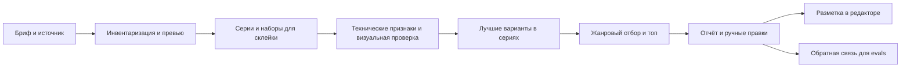

# Silverloupe: дизайн коллекции

Дата: 22 октября 2026. Статус: предложенный дизайн для разработки, реализация не начата.

## 1. Задача и границы

Пользователь снимает свадьбы, архитектуру и пейзажи. Нужно быстро убрать из рабочего отбора брак, разметить фотографии, выбрать лучшие варианты в сериях и топ для дальнейшей обработки. Продолжение работы: Lightroom, Photoshop и LightCraft. Предпочтение: Python через uv, совместимость с Codex и Claude.

«Убрать брак» в этой коллекции означает отметить и исключить из выдачи, не удалять исходник. Автоматическое удаление не входит в проект. Главный риск — потерять значимый или художественно необычный кадр; вторичный — заставить фотографа заново просмотреть почти всё.

Результаты сессии: группы кадров, полный журнал решений, рабочий отбор `selects`, отдельный `top`, очередь `review`, причины отказа, статический HTML contact sheet, JSON/CSV и проверяемый перенос разметки. Первая пользовательская итерация включает установщик с выбором редактора и production-поставку без evals. Интерактивный HTML-review с принятием, отклонением и альтернативами — следующая итерация. Ретушь, проявка, обучение собственной большой модели и полноценный DAM не входят в MVP.

Предлагаемые допущения: первая платформа macOS; Python 3.12; первыми проверяются локальные RAW+JPEG и Lightroom Classic. Пользователь не уточнял Classic/cloud, размеры съёмок, камеры и правило звёзд. Поэтому cloud Lightroom имеет отдельный compatibility gate, объём K задаётся для каждой сессии, а шкала разметки ниже является настраиваемым предложением. Другие ОС — последующие проверяемые цели, не заявленная совместимость.

## 2. Выбор архитектуры

| Подход | Достоинство | Ограничение |
|---|---|---|
| Один большой скилл и просмотр всех кадров моделью | Быстрый эксперимент | Контекст, стоимость, слабая воспроизводимость и смешение задач |
| Только CV/правила и один общий score | Скорость и повторяемость | Плохо выражает момент, жанр и художественные исключения |
| Небольшие скиллы + общее Python-ядро + визуальная оценка | Измеримые этапы, жанры, переносимость | Нужны контракты, evals и адаптеры |

Выбран третий вариант. Массовая работа и запись состояния выполняются кодом; агент управляет процессом и визуальной интерпретацией. До просмотра изображения агент не делает содержательных заключений о нём. При недоступном vision выдаётся технический отчёт, художественный отбор остаётся `not_evaluated`.



## 3. Коллекция скиллов

| Скилл | Когда включается | Что принимает и возвращает | Что не делает |
|---|---|---|---|
| `silverloupe` | «Разбери съёмку», «отбери лучшие» | Путь/альбом + бриф → готовая сессия и отчёт | Не хранит все жанровые инструкции в теле |
| `silverloupe-prepare` | Подготовить фотографии, превью, inventory | Источник → manifest, превью, ошибки чтения | Не оценивает красоту |
| `silverloupe-triage` | Найти технический брак и сомнения | Manifest + группы → технические оценки, review/reject candidates | Не выбирает портфолио и не удаляет файлы |
| `silverloupe-compare` | Разобрать дубли/серии, выбрать вариант | Manifest → группы, связи, сравнения и победители | Не называет остальные варианты техническим браком |
| `silverloupe-curate` | Топ, история, свадебная/архитектурная/пейзажная редактура | Оценки + бриф → selects/top, покрытие, объяснения | Не форсирует заполнение K слабым материалом |
| `silverloupe-deliver` | Перенести готовый отбор в Lightroom/LightCraft | Decisions → diff, отчёт, план переноса и receipt | Не пересчитывает художественные решения |
| `silverloupe-eval` | Проверить/сравнить версии коллекции | Suite + версии → метрики, traces, failure report | Не срабатывает на обычный запрос отбора |

В production входят первые шесть скиллов таблицы. `silverloupe-eval` находится в `dev/skills/` и поставляется только разработчикам, отдельно от пользовательской установки. Evals выполняются до публикации; пользователь получает готовый инструмент и результаты отбора.

`silverloupe` — пользовательская точка входа. Остальные доступны отдельно для повторного запуска этапа. Внутренние зависимости явно объявляются; оркестратор читает нужный `SKILL.md` или использует эквивалентную возможность хоста, а не предполагает наличие универсального «call skill» API. Процесс не требует отдельных субагентов на каждую фотографию.

Калибровка авторского вкуса сначала режим `silverloupe-curate` с reference-профилем. Отдельный `photo-calibrate` имеет смысл лишь после появления самостоятельных повторяющихся сценариев и evals.

## 4. Progressive disclosure

1. **Обнаружение:** короткие name/description шести рабочих скиллов (седьмой eval-скилл доступен только в dev); точные триггеры и различия между обычным отбором и evals.
2. **Рабочая инструкция:** один `SKILL.md` объясняет вход, выход, ключевые ограничения и ссылки. Проектный ориентир 80–180 строк, мягкий потолок 250; измеряется реальный расход контекста, а не только строки.
3. **Условные references:** выбранный жанр, художественные исключения при спорном сигнале, один адаптер редактора на этапе экспорта. Не читать всю коллекцию upfront.
4. **Данные по запросу:** сводка → contact sheet группы → отдельный кадр → кроп исходного масштаба. Полные JSONL и код библиотеки не загружаются в контекст без необходимости.

Общие schemas/profiles имеют один исходник. При сборке необходимые ресурсы копируются в соответствующий skill bundle; генератор проверяет, что копии соответствуют исходнику. Установленный скилл не ссылается на отсутствующий `../../docs`. Общий CLI — явная версионированная зависимость коллекции.

Пример: свадебный запрос включает `silverloupe`, затем нужные этапы; curator читает `wedding.md`, delivery — `lightroom.md`. Архитектурные правила не читаются. Смешанная съёмка размечается по группам и при необходимости использует несколько профилей, а не одно принудительное значение на всю папку.

## 5. Как принимается решение

### 5.1 Бриф

Хранить: жанры, назначение (клиентская выдача/портфолио/печать/соцсети), желаемый K, coverage checklist, ограничения повторов, допустимые художественные приёмы и уже выбранные пользователем кадры. Если K не задан, представить рекомендованный размер и основания, не выдумывать требование пользователя. Широкий рабочий отбор и узкий топ — разные наборы.

### 5.2 Подготовка

Рекурсивное чтение явно заданного источника; подпапки результатов исключаются. Файл имеет `asset_id` на основе корня сессии и относительного пути; content SHA-256 хранится отдельно, чтобы одинаковые байты в разных местах не теряли отдельный учёт. RAW+JPEG связывать по EXIF/времени/камере/имени с оценкой уверенности, не только по одинаковому stem.

Сохранить исходную ориентацию/ICC, рабочее превью нормализовать для просмотра. Рендер по умолчанию: обзор до 1600 px по длинной стороне, contact sheets до 12 кадров с видимыми ID; для деталей отдельные кропы из полноразмерного декодирования. Это стартовые настройки, корректируемые по vision-evals. Измерения не смешиваются между разными масштабами и источниками рендера.

### 5.3 Группы до отбраковки

Различать: byte duplicates, RAW/JPEG companions, near duplicates, burst, HDR brackets, panorama, focus stacks и одиночные кадры. Группа склейки — комплект для дальнейшей работы, а не конкуренты, из которых надо оставить один кадр. Один файл может участвовать в связях разных типов; принудительное плоское разбиение не подходит.

Время + камера + визуальное сходство дают кандидатов, затем проверяется состав. Для нескольких камер учитывать неизвестный сдвиг часов; не менять оригинальный EXIF. Не делать полный O(N²) перебор: временные окна и индекс кандидатов. Сомнительные merge-группы не схлопываются.

### 5.4 Единица отбора и размер K

Ввести `SelectionItem`: `item_id`, `kind=capture|composite`, `member_asset_ids`, `primary_asset_id`, `required_asset_ids`, `group_ids`. RAW+JPEG одного захвата — один capture-item; основной файл по умолчанию RAW, JPEG остаётся связанным вариантом. При сомнительном соответствии — отдельные items до проверки. HDR, panorama и focus stack — один composite-item, представляющий будущий результат склейки; это ещё не готовая фотография. Его обязательные исходники сохраняются полностью. Обычный burst содержит несколько capture-items, между которыми выбирают.

K и все метрики ранжирования считаются по items. Composite занимает одно место и помечается «требует склейки». Если бриф требует только готовые одиночные кадры, composite не входит в top, но комплект остаётся в рабочей выдаче. Selection хранит item IDs, а экспорт раскрывает их в asset IDs. Все required assets выбранного composite получают соответствующую разметку; companions capture-item — только при выбранной политике синхронизации, по умолчанию разметка primary.

Пересекающиеся кандидаты на composite нельзя считать независимыми пунктами top: до разрешения состава они остаются uncertain. Не создавать одновременно capture-item и composite-item с одним исходником в итоговом top; членство и раскрытие проверяются схемой и отдельными тестами. Asset-level технические оценки сохраняются независимо от item-level решения.

### 5.5 Техническая оценка

Сигналы: доступность декодирования, резкость значимого объекта, смаз, экспозиция значимых областей, закрытые глаза относительно сценария, случайное перекрытие объекта. Фокус на глазах применим только там, где глаза действительно нужны; нет лица ≠ брак.

Глобальная дисперсия Лапласиана — baseline, не решение. Сильный шум может выглядеть как детализация; размытый фон может быть намеренным. Экспозиция превью не равна восстанавливаемости RAW. `decode_error`, `unsupported_format` и недостаточное разрешение дают `review/unassessed`, никогда автоматический reject.

В MVP технический отсев — рекомендации. Автоматическая метка reject включается позже только для узких, отдельно откалиброванных случаев. Нужны согласованные свидетельства, отсутствие художественного/сюжетного исключения и пройденный release gate. Единственный кадр важного момента сохраняется в review даже при техническом дефекте.

### 5.6 Сравнение и редактура

Сравнивать близкие кадры бок о бок по фиксированным измерениям: момент/выражение, главный объект, композиция, свет, художественное намерение, техническая пригодность, стоимость исправления. Допускать ничью и несколько полезных вариантов. Хранить `winner_id`, `alternative_ids` и причины выбора, не только балл.

Жанровая редактура выбирает набор с учётом повторов и покрытия. Рабочий baseline — ограниченный жадный выбор по нормированным оценкам с штрафом за избыточность и ограничениями брифа. Эти веса калибруются на dev-наборе. Для top-K выдавать список в порядке силы; не выдавать численную точность, которую никто не измерял. Если достойных меньше K — объяснить недобор. Если coverage конфликтует с K — показать конфликт и лучший допустимый вариант.

Все кадры проходят учёт и обзор; ускорение достигается очередностью глубокой проверки, а не тихим исключением непоказанных фотографий. Визуальный обзор contact sheet не заменяет проверку резкости на отдельном кадре.

## 6. Жанровые профили и художественные исключения

| Профиль | Главные критерии | Не потерять | Пример ошибочного правила |
|---|---|---|---|
| Свадьба | Эмоция, момент, взаимодействие, значимые люди, последовательность событий | Единственный момент; поцелуй/объятие с закрытыми глазами; динамику танца | «Закрытые глаза всегда reject» |
| Архитектура | Геометрия, линия, пространство, свет, материал, цель съёмки | Намеренную перспективу, абстракцию, детали; полные HDR/панорамы | «Вертикали сходятся — брак» |
| Пейзаж | Свет, атмосфера, глубина, тональные отношения, структура | Туман, силуэты, длительную выдержку воды, минимализм, ICM | «Низкий контраст/смаз всегда брак» |

В каждом `references/genres/*.md`: критерии, контрпримеры, пороги эскалации, схема покрытия, примеры сравнений с допустимыми альтернативами. Общий `artistic-intent.md`: soft focus, high/low key, negative space, motion blur/panning, ICM, grain, силуэты и абстракция. Наличие возможного приёма не делает снимок хорошим автоматически: оно снимает безусловную техническую санкцию и требует оценки результата.

Свадебный checklist зависит от реального брифа; не выдумывать отсутствовавшие события и не угадывать личности/родство по лицам. Для коммерческой архитектуры строгость геометрии может быть выше, чем для авторской серии. Профиль автора с примерами предпочтений версионируется отдельно и не превращается в универсальный стандарт.

## 7. Контракты и состояние

Все схемы имеют `schema_version=1`; пути в обменных файлах относительные к явно заданному корню, внутренние действия используют проверенные абсолютные пути.

| Артефакт | Минимальные поля |
|---|---|
| `session.json` | session_id, source_roots, brief, tool/model/profile versions, rendering policy, runtime mode, budget, timestamps, revision, editor_config_snapshot |
| `assets.jsonl` | asset_id, relative_path, content_sha256, media_type, EXIF, dimensions, decode_status, existing_metadata, preview provenance |
| `groups.json` | group_id, type, member_ids, confidence_kind/value, protected_set, evidence |
| `selection-items.json` | item_id, kind, member_asset_ids, primary_asset_id, required_asset_ids, group_ids |
| `assessments.jsonl` | asset_id, technical signals, visual criteria, observed_artifacts, region evidence, intent hypotheses, uncertainty |
| `decisions.jsonl` | item_id, status, tier, rating_proposal, tags, reason_codes, human_reason, group_ids, provenance, decision_authority, user_override |
| `selection.json` | selects_ids, top_ids, ranked_ids (все — item IDs), coverage, unmet_constraints, protected_sets |
| `delivery-plan.json` | target/profile version, asset→target mapping, expected_before hashes/values, proposed changes, conflicts |
| `delivery-receipt.json` | applied/skipped/failed, readback values, backups, rollback data, operation ids, field ownership и baseline/last postimage |

`status = keep | reject | review | unassessed`. `tier = top | select | reserve | none`. Reject не используется для обычных проигравших дублей: это `keep/reserve` с причиной redundancy. `rating_proposal` допускает null; уверенность модели обозначается как некалиброванная, пока отдельная процедура не сделала её вероятностью.

`decision_authority = proposal | user | validated_policy` отделяет рекомендацию от разрешённого решения. В MVP validated_policy для reject отключён. Proposed reject отображается в отчёте; delivery не ставит reject-флаг и не снижает рейтинг, пока пользователь не принял эту рекомендацию. Принятие возможно одним действием для явно показанного списка с хешем версии, без подтверждения каждой фотографии. Обычное «перенеси разметку» не означает принять ещё не подтверждённые reject; явное «применить предложенную отбраковку» означает. Неподтверждённые reject остаются в отчёте/ключевом слове suggested-reject, а receipt фиксирует неприменённый флаг.

Пример: `status=review, tier=none, reason_codes=[focus_uncertain, unique_moment], observed_artifacts=[overview_17,crop_17_eyes]`. Формулировка «в фокусе» допустима только при доступном свидетельстве нужного масштаба.

Manual overrides имеют приоритет и сохраняются при повторном прогоне. Overrides адресуются по item_id, хранят revision и scope набора; исключение из top/selects не равно техническому reject. Контракт позволяет добавить интерактивный review позже без изменения смысла старых решений. SQLite хранит checkpoint/cache, JSONL — обмен и аудит. Ключ кэша зависит от содержимого, версий моделей, профиля и параметров рендера; изменение брифа инвалидирует редактуру, а не все превью. После прерывания возможен resume без повторной оплаты завершённых запросов, насколько это позволяет провайдер.

## 8. Режимы запуска и скорость

Python-ядро: Python 3.12, uv, Pillow/NumPy, Pydantic, SQLite; pytest только в dev. ExifTool — проверяемая внешняя зависимость; rawpy подключается для RAW, если нет проверенного полноразмерного рендера редактора. Требования к vision capabilities, CPU/RAM, диску и dependency profiles описаны в [requirements](../../requirements.md). OpenCV/embedding/IQA — кандидаты после baseline, не обязательный стек MVP. Веса и лицензии моделей проверяются до включения.

Три режима: `local` (только локальные алгоритмы/модели), `host-vision` (изображения видит модель Codex/Claude), `api` (явно выбранный провайдер). Запуск через локальную команду не делает host-vision офлайн. Офлайн-режим не включает сетевую модель скрытно. Авторизация и настройка API не требуются для чтения плана.

Первый MVP использует host-vision через передачу ограниченных batch и структурированных ответов. Для unattended массовых запусков отдельный API-provider реализуется позже; он должен соблюдать те же схемы. CLI без vision умеет подготовку и численные признаки, но не обещает полноценного художественного выбора.

Бюджеты сессии: время, число vision-батчей, запросы полноразмерных кропов, стоимость при наличии тарификации. При исчерпании — checkpoint, partial report и review, без выдачи незавершённого отбора за завершённый. Режимы `fast`/`balanced`/`careful` меняют глубину проверки, не определение истины.

## 9. Разметка и интеграции

Установщик выбирает default editor и режим записи. Каждая сессия сохраняет их snapshot; `silverloupe-deliver` использует выбранный MetadataBackend, а не произвольный writer. Нативная запись через приложение предпочтительна при проверенной capability. XMP exchange — явно настроенный режим, не скрытый fallback. Подробности мастера, capability-проверок и поставки: [distribution](../../distribution.md).

Предлагаемая шкала для новых пустых рейтингов: 5 — top, 4 — основной select, 3 — полезный резерв. Review — ключевое слово `silverloupe:review`, рейтинг null. Reject — отдельный status/проверенный флаг; не кодировать его произвольно одной звездой. 1–2 не назначать автоматически в MVP. Существующие пользовательские звёзды сохранять; конфликт показывать в delivery-plan. Цвета настраиваются, универсального значения цвета не предполагать.

| Получатель | Первая реализация | Проверка перед заявлением поддержки |
|---|---|---|
| Lightroom Classic, проприетарный RAW | Merge разметки в копию существующего XMP; staged plan; перенос рядом с RAW по разрешённой операции | Прочитать метаданные в тестовом каталоге; рейтинг/keywords/labels; отсутствие изменений develop |
| Lightroom Classic, JPEG/TIFF/DNG/PSD | Отдельный compatibility probe; при отсутствии безопасного sidecar-пути — копии с встроенной разметкой либо будущий catalog adapter | Реальный импорт/readback для каждого формата; не обещать универсальный sidecar |
| Photoshop | Передать выбранные файлы через Bridge/Camera Raw, рейтинг и keywords через проверенный XMP | Состав выбора, разметка, открытие файла, сохранность XMP/ACR |
| Lightroom cloud | Отдельный сценарий импорта/экспорта после уточнения версии | Не переносить выводы Classic без теста |
| LightCraft | MCP-адаптер `photo.rate/flag/label` с явными `ids`, затем readback | Mapping ID↔исходник, частичный сбой, повторное применение, сохранность develop |

Подготовка отчёта и staged sidecars не меняет оригиналы. Применение действует в пределах запроса пользователя; если перенос уже запрошен, дополнительный ритуал подтверждения не нужен. При нерешённом конфликте существующей разметки конфликтующие элементы пропускаются и показываются отдельно. Автоматическое удаление отсутствует.

Не менять `.lrcat` напрямую и не пересоздавать XMP с нуля поверх существующей обработки. Перед записью сверять preimage; стороннее изменение после plan → conflict. Rollback восстанавливает только собственные изменения при совпадении postimage. Для набора файлов нужен журнал по каждому элементу: общей атомарной транзакции файловой системы не предполагается. При пересмотре уже экспортированного отбора собственные поля обновляются/снимаются по предыдущему receipt только при совпадении postimage; исходные пользовательские значения восстанавливаются, внешние изменения дают конфликт. Полное правило ownership описано в [distribution](../../distribution.md).

## 10. Dev и install-поставка

Dev-репозиторий — единственный исходник. Install-репозиторий и release-архив автоматически собираются из release tag; содержат только рабочие компоненты. Подробный состав, установщик, обновление и критерии приёмки описаны в [distribution](../../distribution.md).

```text
skills/                         # 6 production-скиллов, единые исходники
  silverloupe/SKILL.md
  silverloupe-prepare/SKILL.md
  silverloupe-triage/SKILL.md
  silverloupe-compare/SKILL.md
  silverloupe-curate/SKILL.md
  silverloupe-deliver/SKILL.md
dev/skills/silverloupe-eval/   # только для разработки
resources/
  genres/{wedding,architecture,landscape}.md
  artistic-intent.md
  adapters/{lightroom,photoshop,lightcraft}.md
  contracts.md
  templates/report/             # статический отчёт первой итерации
  templates/review/             # будущая интерактивная версия, итерация 2
src/silverloupe/              # runtime; не импортирует evals/tests
  installer/                    # выбор хоста/редактора и настройка
  delivery/                     # backend записи выбранной программы
tests/{unit,integration,contracts}/
evals/{cases,rubrics,baselines}/
tools/build_collection.py
packaging/production-manifest.json
pyproject.toml                  # изолированные dev/eval dependency groups
uv.lock
.python-version
dist/                          # генерируемая production-поставка
```

Builder укладывает только нужные runtime references рядом с рабочими SKILL.md и проверяет замкнутость ссылок. В production отсутствуют eval-скилл, harness, тестовые данные, dev-документы и dev-зависимости. Проверка входов/записи и диагностика установки остаются частью продукта.

Установщик регистрирует Codex-скиллы в `.agents/skills`, Claude Code — в `.claude/skills`, в выбранной пользователем области. Оба дерева генерируются; runtime location хранится в конфигурации установки, не в абсолютном пути разработчика. Установка из чистого release проверяется без доступа к dev-репозиторию. Отдельный SKILL.md без runtime не считается полной поставкой.

Пользователь выбирает один или несколько редакторов и основной backend. Неподдержанная версия честно остаётся report-only. Обновление сохраняет настройки/сессии; удаление затрагивает только принадлежащие установке файлы. Plugin distribution можно добавить позже, после установщика и локально проверенной коллекции.

### 10.1 HTML-review после первой итерации

Версионированный HTML/CSS/JS-шаблон показывает карточку кадра, причины выбора, принять/отклонить/пропустить/undo и альтернативы из той же серии. Swipe дублируется кнопками и клавиатурой. Решения сохраняются как overrides, а отдельное применение использует редактор, выбранный в установщике. При отсутствии альтернатив остаётся честный недобор.

Отклонение из набора не ставит технический reject. Работа с top и selects явно разделяется, composite-наборы сохраняются. Контракт событий, сохранение прогресса и проверки описаны в [дизайне HTML-review](2026-10-22-silverloupe-review-ui-design.md). В первой итерации остаётся статический отчёт; будущие UI-ресурсы не включаются в production до готовности.

## 11. Критерий успеха и зависимости

Основные метрики: сохранение хороших/значимых кадров, precision технического reject, полнота покрытия, приемлемость top, число ручных исправлений и общее время до готовой выдачи. Изолированная «accuracy 95%» на несбалансированных данных не является критерием готовности.

Нужны реальные съёмки и разметка фотографа; до их получения можно проверить файловую надёжность и маршрутизацию, но нельзя утверждать качество художественного отбора. Предлагаемые пороги, статистические ограничения и наборы описаны в [evals](../../evals.md); задачи реализации — в [плане](../plans/2026-10-22-silverloupe.md).

Приоритет: одна сквозная рабочая сессия → сохранность разметки → защита художественных исключений → сравнение с baseline → расширение жанров и скорости. Отдельные тяжёлые ML-компоненты, обучение на предпочтениях и plugin packaging добавляются только после доказанной пользы.
